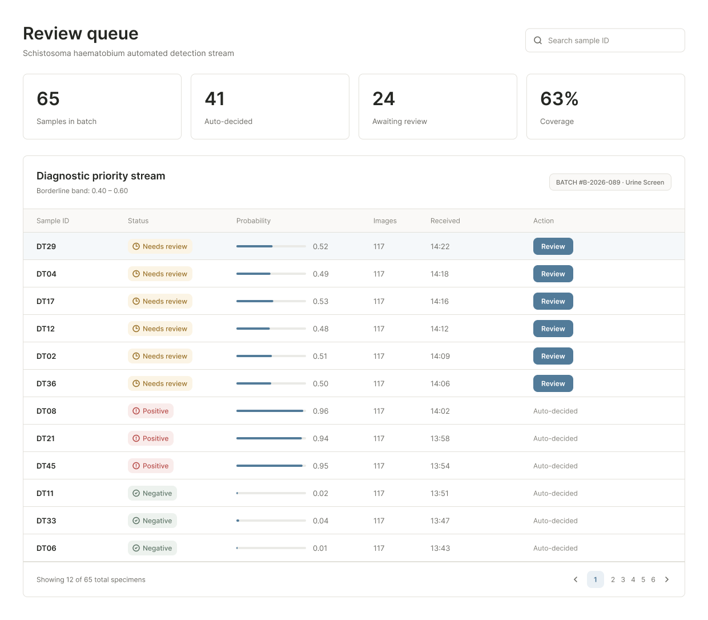
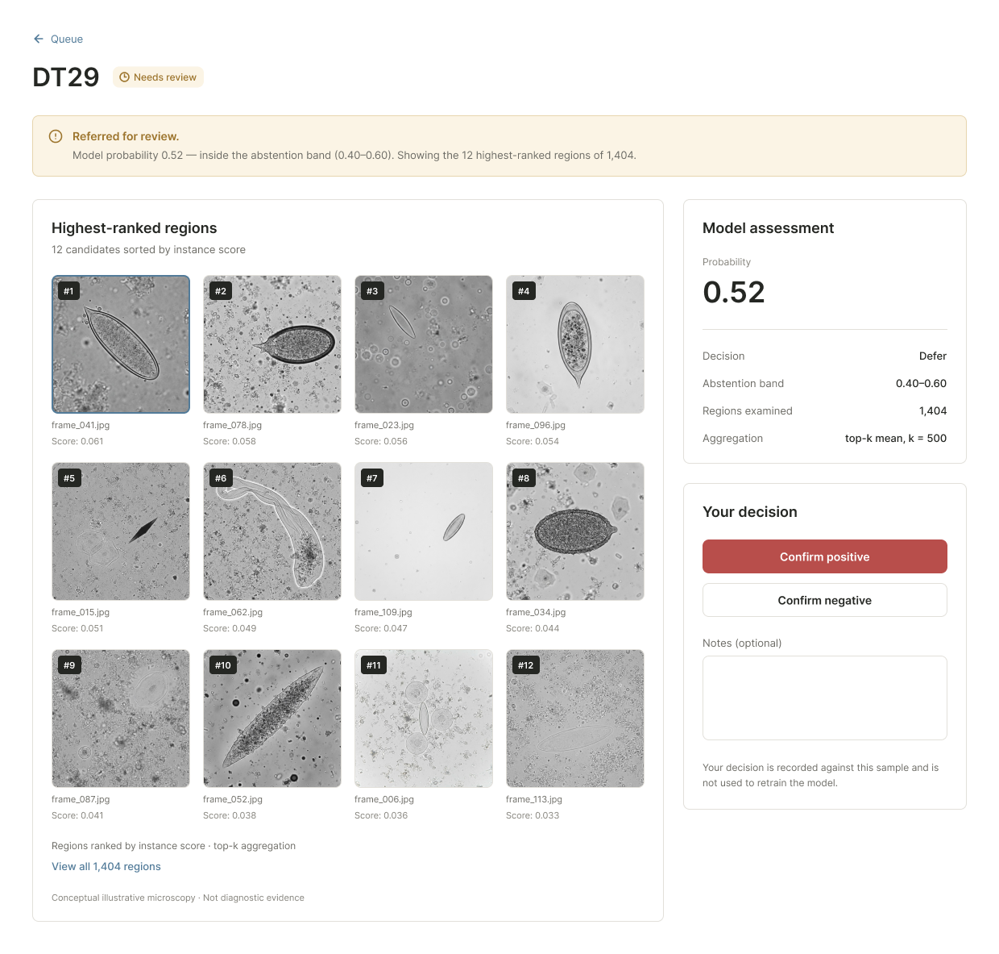
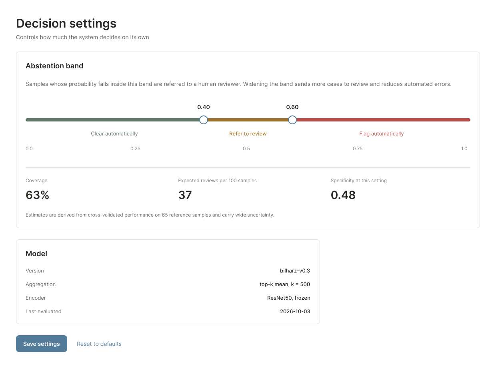

# Bilharz

Patient-level triage for urogenital schistosomiasis, using uncertainty-aware
aggregation and human-in-the-loop deferral.

Final-year capstone · BSc Software Engineering (Machine Learning) ·
African Leadership University · Glory Paul

| | |
|---|---|
| **Repository** | https://github.com/Glorycodess/bilharz |
| **Live API** | https://bilharz.onrender.com/docs |
| **Figma mockups** | https://www.figma.com/design/yNDxzYmsbYGOrhljmDWXmz/Bilharz |
| **Video demo** | https://youtu.be/ufj1dCEyPjw |

---

## 1. Description

### What schistosomiasis is

Schistosomiasis — bilharzia — is caused by parasitic blood flukes. Freshwater
snails release larvae that penetrate human skin on contact with infested water.
Inside the body the larvae mature into adult worms that live in blood vessels. Some
of their eggs leave in urine or faeces and re-enter the water, continuing the cycle;
the rest lodge in tissue, where the immune reaction to them causes the actual
disease.

**Urogenital schistosomiasis**, caused by *Schistosoma haematobium*, is the form
this project targets. Its classic sign is blood in the urine. Left untreated it
progresses to fibrosis of the bladder and ureters, kidney damage, and in late stages
bladder cancer.

In women it causes **female genital schistosomiasis** — genital lesions, vaginal
bleeding, pain during intercourse, vulval nodules, and ectopic pregnancies. It is a
recognised risk factor for HIV infection, particularly in women. In men it damages
the seminal vesicles and prostate, causes blood in semen and painful ejaculation,
and can lead to infertility. In children it causes chronic anaemia, stunted growth
and impaired learning, and because a child rarely looks acutely ill it can run
untreated for years.


### Who it affects

Poor rural communities without safe water or sanitation. Farmers, fishermen and
irrigation workers whose work puts them in the water. Women washing clothes in
infested rivers. And above all **school-aged children**, who swim, play and fish in
the same water — carrying chronic infections that cause anaemia, stunted growth and
impaired learning during the years that matter most.

As of 2024, WHO reports:

| Measure | Figure |
|---|---|
| People requiring preventive treatment | **253.7 million** |
| People actually treated | **100.5 million** |
| Proportion of those needing treatment who received it | **39.6%** |
| Proportion of those requiring treatment who live in Africa | **≥ 93.9%** |

Nearly 94% of the global burden sits in Africa, and well under half of those who
need treatment get it.

### Why diagnosis is the bottleneck

Treatment is cheap and effective. The hard part is knowing who to treat. Diagnosis
means finding parasite eggs in urine under a microscope — slow, skilled work, in
places with few trained microscopists.

The **Schistoscope** is an automated microscope built for exactly this. It
photographs each urine sample as **117 field-of-view images** and runs a detector on
every one. The patient-level verdict then uses an **any-detection rule**: if an egg
is detected in any single frame, the patient is called positive.

Meulah et al. (2022), across 487 participants in rural Nigeria, measured what that
costs:

| | Sensitivity | Specificity |
|---|---|---|
| Semi-automated (human reviews flagged images) | 80.1% | **95.3%** |
| Fully automated (any-detection rule) | 87.3% | **48.9%** |

Roughly half of healthy people are told they have a parasitic infection.

That matters in both directions. A missed infection leaves a child carrying a
disease that will scar their bladder and shorten their schooling. A false positive
wastes a dose and, repeated across a community, erodes trust in the screening
programme that the whole control effort depends on.

### What this project does

The failure above is not in detection. It is in **aggregation** — the step that
turns 117 image-level outputs into one patient-level decision — and that step has
not been treated as a modelling problem in this pipeline.

Bilharz builds that step, and adds what the published system lacks: the ability to
**abstain** and refer an uncertain case to a human rather than guess.


*Reading left to right: the microscope hands over all 117 images of a sample, and
Bilharz works through every region of every frame before producing a single
probability for the patient. Only the cases that land inside the uncertainty band
reach a person — and that person opens twelve ranked regions rather than 117 full
frames. In the current build the API reads a stored sample rather than accepting an
upload; section 4 covers what that would take.*


*Four of the 117 frames from one heavily infected patient (516 eggs) and one
negative patient. Most frames contain no egg at all, even for the positive sample —
which is why a per-image rule fails at the patient level.*

## 2. Setting up the environment

### Trying it without installing anything

The API is live at **https://bilharz.onrender.com/docs**. Open it, expand
`GET /samples/{sample_id}/predict`, click **Try it out**, and enter a sample ID.

Try `DT29` for a referral, `DT12` for a confident positive, `DT02` for a confident
negative.

It runs on Render's free tier, which puts the service to sleep after fifteen minutes
of inactivity. The first request after that takes about fifty seconds while the
container wakes. It is not broken — give it a moment.

### Requirements
- Python 3.10+
- A Kaggle account (for the notebooks — they need a GPU and the hosted dataset)
- Git

### Running the API locally

```bash
git clone https://github.com/Glorycodess/bilharz.git
cd bilharz/api
python3 -m venv venv
source venv/bin/activate          # Windows: venv\Scripts\activate
pip install -r requirements.txt
uvicorn app:app --reload
```

The same interface is then served at `http://127.0.0.1:8000/docs`, with no cold
start. That address only resolves on the machine running the command above — it is
not a link you can follow from here.

### Running the notebooks

The notebooks run on Kaggle, not locally: they need a GPU, and they download their
datasets from Zenodo. Run each with **Save & Run All (Commit)** so its outputs are
kept.

| Notebook | What it does | Kaggle settings |
|---|---|---|
| `01-data-collection.ipynb` | Downloads the diagnosis dataset, verifies its MD5, asserts the 65 × 117 structure, and writes a manifest and provenance record | Internet on |
| `02-data-preparation.ipynb` | Data preparation and exploratory analysis; the baseline with frozen ImageNet features: aggregation comparison and the first deferral test | Internet on, GPU T4 |
| `03-detection.ipynb` | Trains the egg detector on tiles from a separate dataset, labelled from expert masks | Internet on, GPU T4 |
| `04-prediction.ipynb` | Scores all 65 patients with the detector, applies the triage rule, compares it with alternative systems, and evaluates deferral | Internet on, GPU T4, output of `03` attached |

Notebook 04 takes about 55 minutes end to end, most of it the 12.5 GB download.
Its tile scores are saved to `results/patient_scores.npz`, so every analysis after
scoring can be re-run from that file without the images.

## 3. Designs

Seven screens covering the reviewer workflow. The working file is on
[Figma](https://www.figma.com/design/yNDxzYmsbYGOrhljmDWXmz/Bilharz); full-resolution
exports are in `design/`.

| Screen | Purpose |
|---|---|
| Sign in | Authentication; notes that all review actions are logged |
| Review queue | Samples the model decided, and those it referred to a human |
| Sample review | The 12 highest-scoring regions of 1,404, with confirm / override |
| Sample record | Final verdict and full decision trail for audit |
| All samples | Searchable archive, showing which verdicts were model vs human |
| Batch report | Outcome breakdown and review statistics for a completed run |
| Decision settings | The abstention band, with coverage and specificity shown live |





**Navigation.** Four top-level destinations in a persistent left rail — Queue,
Samples, Reports, Settings. A technician lives in Queue; everything else is
reference. The primary path is Queue → Review → Record, and each step carries a back
link to the one before it. Status is never communicated by colour alone: every state
is a pill containing an icon and a word.

**Decision settings** is the screen that carries the project's argument. The
abstention band is a draggable range, and widening it shows coverage falling and
specificity rising in real time — the central trade-off of the system, made
adjustable rather than buried in a config file.

**Known gap.** There is no upload screen. The flow in section 1 begins with a
technician uploading a sample folder, and no mockup covers that step — it is the
first screen to add, ahead of Batch report, which nothing in the current pipeline
produces.

## 4. Deployment plan

**Current.** The API is a FastAPI service with auto-generated OpenAPI docs, deployed
to Render's free tier from this repository at
[bilharz.onrender.com](https://bilharz.onrender.com/docs). Pushes to `master`
redeploy automatically. It serves stored probabilities from the earlier, pre-detector model rather than
running live inference — it demonstrates the decision path, not production serving. The free tier
sleeps after fifteen minutes idle, so the first request wakes the container and takes
roughly fifty seconds.

**Next.** Package the trained model with the service, load weights at startup, and
accept an uploaded sample folder instead of a sample ID. Add a persistent store for
reviewer decisions, which currently live in memory. Containerise so the same image
runs locally, in CI, and in a hospital's own infrastructure — relevant because these
laboratories often cannot send patient data to a third-party cloud.

**Longer term.** The Schistoscope is a field device, often used with intermittent
connectivity. A realistic deployment runs inference on or beside the microscope and
synchronises records when a connection is available, rather than assuming a live
server.

## 5. Video demo

**[Watch the demo (YouTube)](https://youtu.be/ufj1dCEyPjw)**

A walkthrough of the clinical problem, the aggregation design, the modelling
notebook and its cross-validation, a live call against the deployed API showing a
deferred case, and the limitations.

---

## Data

[Schistosoma Haematobium Egg Image Dataset](https://doi.org/10.5281/zenodo.6467268) ·
Zenodo · CC-BY-4.0

- 65 patient samples (DT01–DT65), **exactly 117 images each**, 7,605 total
- 32 positive, 33 negative
- Expert egg counts 0–516; **nine positives have ≤5 eggs**
- Original resolution 2028 × 1520

The archive is verified against its published MD5 before use, and the 65 × 117
structure is asserted rather than assumed. A `manifest.csv` and `provenance.json`
are written alongside the images so the dataset can be reproduced exactly.


Those nine low-burden positives are not an edge case to be tidied away. A light
infection is an early infection — the patient you most want to catch, before the
scarring starts. They are also where a single missed or spurious detection among
1,404 regions flips the verdict.

## Method

### Baseline: frozen ImageNet features (notebook 02)

The first approach encoded each frame, and each tile of a 3 × 4 grid, with a frozen
ImageNet ResNet50, and compared gated attention MIL (Ilse et al., 2018) with mean-
and max-pooling. Two findings shaped everything after it:

- **Attention MIL did not beat max-pooling** at n = 65. It concentrated confidently
  on the wrong instances: with 52 training bags and no instance-level supervision,
  the parameter-free operator wins because it has nothing to overfit.
- **Confidence-based deferral was no better than random** (AURC 0.2755 vs 0.2829).
  Features trained on everyday photographs carry no knowledge of what an egg looks
  like, so the model's confidence did not track its errors.

The conclusion was that a scorer trained on eggs was required, not optional.

### Egg detector (notebook 03)

A ResNet18, pre-trained on ImageNet and then fully fine-tuned, scores 256 × 256
tiles. Training tiles come from **SHdataset_12k**, a separate dataset with
expert-drawn egg masks and **no patients in common** with the 65 used for
evaluation. Each frame is resized to 1024 × 768 and cut into a 3 × 4 grid, the
same geometry used at inference; a tile is positive if it holds at least 500
marked egg pixels. About 32,000 tiles were used, with random flips and rotations.
Validation AUROC on held-out tiles is **0.985**.

### Patient-level triage (notebook 04)

Each patient's 117 frames give **1,404 tiles**, each scored by the detector. The
patient is summarised by how many tiles the detector is confident contain an egg,
and a three-way rule decides:

| Confident tiles | Decision |
|---|---|
| None | Cleared automatically (negative) |
| More than any healthy patient in training | Flagged automatically (positive) |
| In between | **Referred to a reviewer** |

The confidence threshold and both cut-offs are learned from training patients only.

### Validation

Repeated stratified 5-fold cross-validation, 20 repeats, split over **patients**,
so all of a patient's tiles stay on the same side of a split. Every choice a system
makes, including the confidence threshold, is made inside the folds. Samples
referred to a reviewer are assumed to be read correctly, the same assumption behind
the full-review baseline. 95% intervals are exact Clopper–Pearson intervals over
patients.

## Results

### The any-detection failure reproduces

Calling a patient positive if any tile scores above 0.5, the logic of the
Schistoscope, gives **100% sensitivity and 0% specificity**: every healthy sample
contains at least one confident false alarm among its 1,404 tiles.

### The detector separates patients

| Patient score | AUROC |
|---|---|
| Highest tile (max) | **0.950** |
| Mean of top 3 tiles | 0.903 |
| Mean of all tiles | 0.616 |

Averaging dilutes the signal, because egg tiles are rare. The maximum, though,
saturates: many healthy patients also have one tile near 1.0, which is why the
triage rule counts confident tiles instead.


### Comparison with alternative systems

All systems evaluated on the same held-out patients:

| System | Sensitivity | Specificity | Samples reviewed |
|---|---|---|---|
| Any-detection (tile > 0.5) | 100.0% | 0.0% | 0% |
| Max score, single threshold | 85.6% | 83.6% | 0% |
| Count, single threshold | 79.4% | 86.7% | 0% |
| Random deferral | 88.8% | 93.3% | 45.8% |
| **Triage (Bilharz)** | **96.9%** | **96.7%** | **45.8%** |
| Full human review | 100.0% | 100.0% | 100% |

With intervals: sensitivity **96.9% (83.8–99.9%)**, specificity **96.7%
(83.8–99.9%)**, samples reviewed **45.8% (33.4–58.7%)**.

Fully automatic systems miss 15–21% of infected patients. Random deferral, with
exactly the same reviewer workload as triage, does markedly worse: what matters is
*which* samples go to the reviewer.

### Confidence-based deferral beats random deferral

| | AURC (lower is better) | Error at 50% coverage |
|---|---|---|
| **Confidence** | **0.095 ± 0.013** | **8.0%** |
| Random | 0.206 ± 0.016 | 20.9% |
| Oracle (best possible) | 0.024 | — |

Confidence beats random in **20 of 20** repeats. With the frozen ImageNet features
of notebook 02, the two were indistinguishable.


### The one missed infection, and a safety margin

The single missed infection is one patient, DT40 (7 eggs). Its eggs score between
0.99 and 0.995, and it was cleared only in folds where it was held out and the
training patients chose the stricter threshold.

A variant **designed after this failure was observed**, and reported as an extra
analysis rather than the main result, adds a safety margin: a threshold may be
chosen only if every infected training patient has at least two confident tiles.

| | Sensitivity | Specificity | Samples reviewed |
|---|---|---|---|
| Triage | 96.9% | 96.7% | 45.8% |
| Triage + safety margin | 100.0% (≥ 89.1%) | 96.5% | 72.1% |

The margin prevents the observed miss at the cost of more review. The two
sensitivity intervals overlap, so the margin is not shown to be more sensitive;
the workload difference is clear.

### What the hard cases look like


*The six highest-scoring tiles for the three healthy patients with the most
confident tiles (top) and the three infected patients with the fewest (bottom).*
Confident false alarms concentrate in debris- and fibre-heavy samples; the
hardest infected patients carry a single egg. By count alone the two cannot be
told apart, which is the case for referring them to a reviewer.

## Findings

1. **The failure is in the decision rule, not the detector.** The same scores give
   0% specificity under any-detection and 96.7% under triage.
2. **A trained detector is what makes deferral work.** Generic features gave
   deferral no better than random; the detector gives AURC 0.095 against 0.206.
3. **Triage reaches near-full-review accuracy at less than half the workload**, on
   this cohort: 96.9% sensitivity and 96.7% specificity with 45.8% of samples
   reviewed.
4. **Simple aggregation of a good detector beats learned aggregation** at this
   sample size.
5. **Safety and workload trade off directly.** Preventing the one observed miss
   raises review from 46% to 72%.

## API endpoints

| Endpoint | Purpose |
|---|---|
| `GET /samples/{id}/predict` | Score a sample; return a verdict **or a referral** |
| `GET /review/queue` | Samples the model declined to decide |
| `GET /review/{id}/regions` | The regions a reviewer should inspect, ranked |
| `POST /review/{id}/decision` | Record a reviewer's verdict for audit |
| `GET` / `PUT /settings` | Read or change the abstention band |

Reviewer verdicts are stored for audit and are **not** used to retrain the model.

## Repository structure

```
bilharz/
├── api/          FastAPI service and dependencies
├── notebooks/    Data collection, preparation, detection and prediction
├── results/      Saved tile scores for the 65 patients
├── figures/      Generated figures and the system diagram
├── design/       Interface mockups
└── README.md
```

An earlier exploratory notebook (`01-bags-and-mil`) was superseded and removed; it
remains in the repository history.

## Limitations

**n = 65.** Every estimate carries a wide interval: sensitivity and specificity
are plausibly anywhere from the mid-80s to near 100%. The results show the
approach works on this cohort; they do not establish clinical performance.

**One dataset, no external validation of the triage rule.** The detector is tested
on patients it never saw, from a different dataset, but the triage cut-offs are
learned and tested within the same 65 patients. A prospective cohort from another
site is required.

**The cut-offs depend on the most extreme patients in training.** The upper cut-off
moves with the healthy patient with the most confident tiles; the clearing rule
depends on the faintest infected patient, as DT40 shows.

Smaller constraints:

- Reviewer behaviour is simulated against the expert microscopist reference
  standard. No human participants are involved.
- The detector's false alarms concentrate in debris- and fibre-heavy samples.
- Tiles do not overlap, so an egg on a tile boundary is split across two tiles.
- Published Schistoscope figures come from a different detector and pipeline, so
  they are context rather than a like-for-like comparison.
- The deployed service predates the detector and still serves the earlier model.
- Interface mockups use conceptual illustrative microscopy, not diagnostic imagery.

## Next

1. Serve the detector and triage rule from the API, with the safety margin as the
   default setting
2. Build the reviewer interface around the ranked tiles
3. Retrain the detector with debris and fibre examples as negatives
4. Validate prospectively on field samples from another site

## References

World Health Organization (2025). *Schistosomiasis fact sheet.*
https://www.who.int/news-room/fact-sheets/detail/schistosomiasis

Meulah, B., Oyibo, P., Bengtson, M., Agbana, T., Lontchi, R. A. L., Adegnika, A. A.,
Oyibo, W., Hokke, C. H., Diehl, J. C., van Lieshout, L. (2022). Performance
evaluation of the Schistoscope 5.0 for (semi-)automated digital detection and
quantification of *Schistosoma haematobium* eggs in urine: a field-based study in
Nigeria. *American Journal of Tropical Medicine and Hygiene* 107(5), 1047–1054.
https://doi.org/10.4269/ajtmh.22-0276

Oyibo, P., Jujjavarapu, S., Meulah, B., Agbana, T., Braakman, I., van Diepen, A.,
Bengtson, M., van Lieshout, L., Oyibo, W., Vdovine, G., Diehl, J. C. (2022).
Schistoscope: an automated microscope with artificial intelligence for detection of
*Schistosoma haematobium* eggs in resource-limited settings. *Micromachines* 13(5),
643. https://doi.org/10.3390/mi13050643

Ilse, M., Tomczak, J. M., Welling, M. (2018). Attention-based deep multiple instance
learning. *ICML*.

Geifman, Y., El-Yaniv, R. (2017). Selective classification for deep neural networks.
*NeurIPS*.
