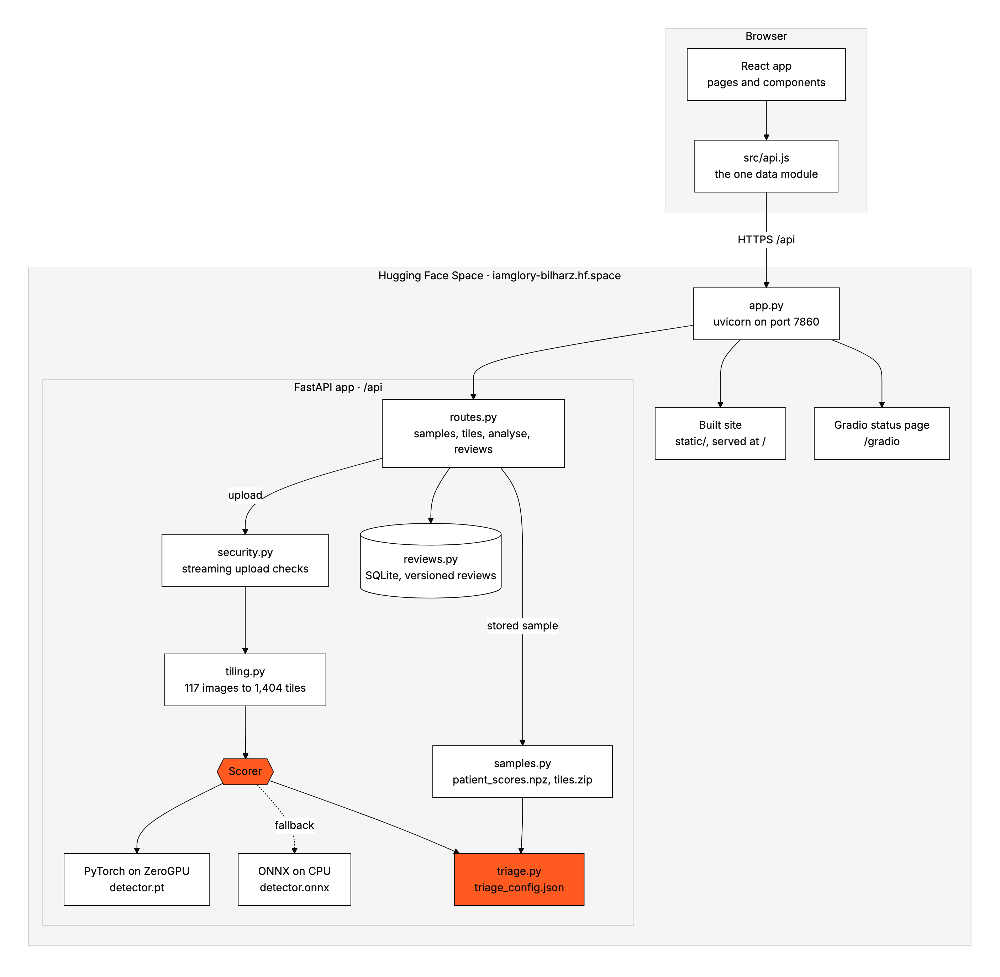
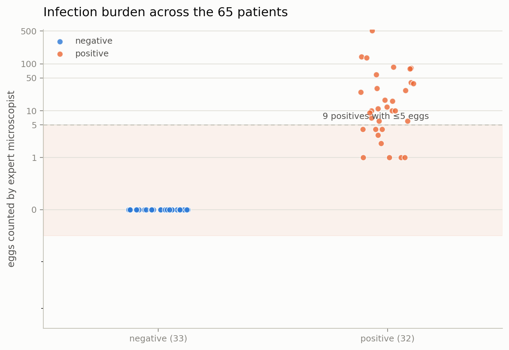
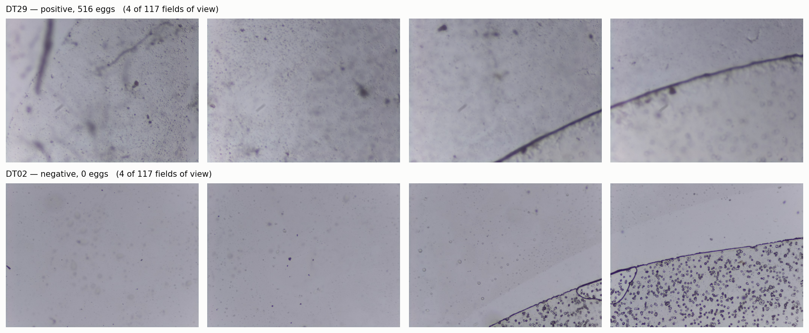
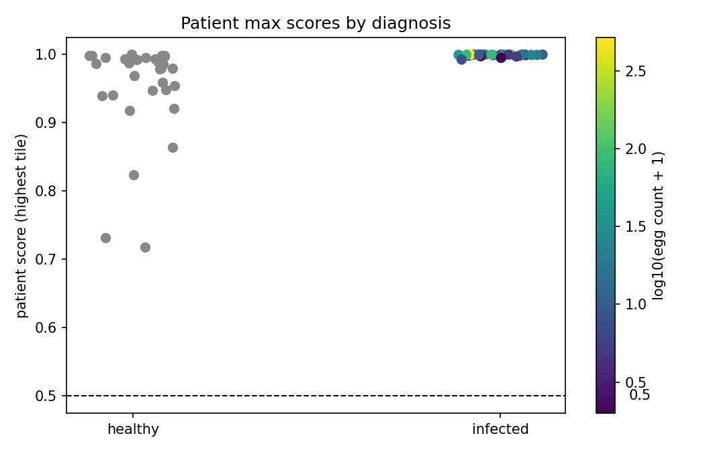
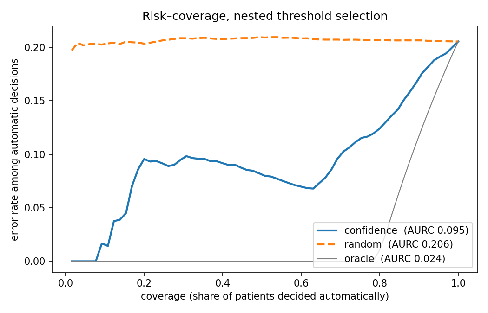
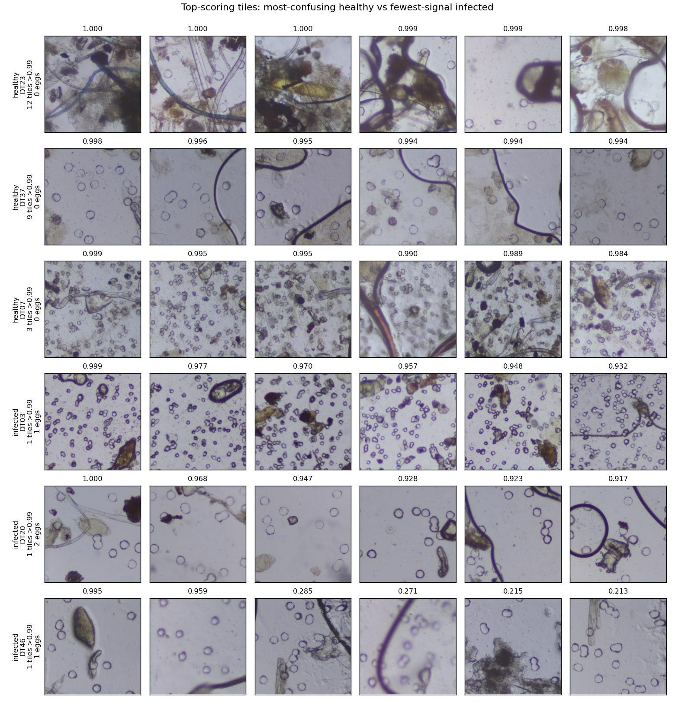

# Bilharz

Patient-level triage for urogenital schistosomiasis from urine microscopy: an egg
detector decides the clear cases, and refers the uncertain ones to a human reviewer.

Final-year capstone · BSc Software Engineering (Machine Learning) ·
African Leadership University · Glory Paul

| | |
|---|---|
| **Repository** | https://github.com/Glorycodess/bilharz |
| **Live API** | https://bilharz.onrender.com/docs |
| **Figma** | https://www.figma.com/design/yNDxzYmsbYGOrhljmDWXmz/Bilharz |
| **Video demo** | https://youtu.be/ufj1dCEyPjw |

---

## 1. Description

### The disease

Schistosomiasis, or bilharzia, is caused by parasitic worms picked up from
infested fresh water. In the urogenital form, caused by *Schistosoma haematobium*,
the worms' eggs pass out in urine; the eggs that stay behind lodge in the bladder
and genital tract, causing bleeding, scarring, kidney damage, infertility, and in
late stages bladder cancer. In women it causes female genital schistosomiasis and
raises the risk of HIV. In children it causes anaemia, stunted growth and impaired
learning, often for years before anyone notices.

As of 2024, WHO reports:

| | |
|---|---|
| People requiring preventive treatment | **253.7 million** |
| Share of them who received it | **39.6%** |
| Share of them living in Africa | **≥ 93.9%** |

Treatment is cheap and effective. The bottleneck is diagnosis: finding eggs in
urine under a microscope is slow, skilled work, in the places with the fewest
trained microscopists.

### The problem with automated screening

The **Schistoscope** is an automated microscope built for this. It photographs each
urine sample as **117 images** and runs an egg detector on each one. The patient is
then called positive if an egg is detected in **any** image.

That rule is the weak point. Across 117 images, a single piece of debris mistaken
for an egg is enough to misdiagnose a healthy person. In a field study of 487
participants in Nigeria (Meulah et al., 2022):

| | Sensitivity | Specificity |
|---|---|---|
| Fully automated (any-detection rule) | 87.3% | **48.9%** |
| Semi-automated (human reviews the results) | 80.1% | 95.3% |

Fully automated, about half of healthy people are told they are infected. Making it
reliable requires a human to review the output, which brings back the workload the
device was meant to remove.

### What Bilharz does

Bilharz replaces the any-detection rule with **triage**. Each sample gets one of
three outcomes:

| Outcome | When |
|---|---|
| **Negative**, decided automatically | The detector is confident about no egg anywhere |
| **Positive**, decided automatically | The detector is confident about many eggs |
| **Referred to a reviewer** | The evidence is in between |

The reviewer sees only the referred samples, and for each one only the image
regions the detector ranked highest, instead of 117 full images.

**Results on 65 patients**, with every threshold learned on separate patients:

| | Sensitivity | Specificity | Samples a human reviews |
|---|---|---|---|
| Any-detection rule | 100.0% | 0.0% | 0% |
| **Bilharz triage** | **96.9%** | **96.7%** | **45.8%** |
| Full human review | 100% | 100% | 100% |

On this cohort, triage approaches full-review accuracy with less than half the
review workload. The Results section below gives the full comparison, intervals, and the one
infection it missed.



## 2. Setting up the environment

### Trying it without installing anything

The API is live at **https://bilharz.onrender.com/docs**. Expand
`GET /samples/{sample_id}/predict`, click **Try it out**, and enter a sample ID
from `DT01` to `DT65`.

It runs on Render's free tier, which sleeps after fifteen minutes idle. The first
request after that takes about fifty seconds while the service wakes.

### Requirements

- Python 3.10+
- Git
- A Kaggle account, for the notebooks (they need a GPU)

### Running the API locally

```bash
git clone https://github.com/Glorycodess/bilharz.git
cd bilharz/api
python3 -m venv venv
source venv/bin/activate          # Windows: venv\Scripts\activate
pip install -r requirements.txt
uvicorn app:app --reload
```

The interface is then served at `http://127.0.0.1:8000/docs`.

### Running the notebooks

The notebooks run on Kaggle and download their data from Zenodo. Run each with
**Save & Run All (Commit)** so its outputs are kept.

| Notebook | What it does | Kaggle settings |
|---|---|---|
| `01-data-collection.ipynb` | Downloads the diagnosis dataset, verifies its checksum, and checks its structure | Internet on |
| `02-data-preparation.ipynb` | Data preparation and exploratory analysis, and a baseline using generic image features | Internet on, GPU T4 |
| `03-detection.ipynb` | Trains the egg detector on a separate, expert-annotated dataset | Internet on, GPU T4 |
| `04-prediction.ipynb` | Scores all 65 patients, applies triage, compares it with alternative systems, and evaluates deferral | Internet on, GPU T4, output of `03` attached |

Notebook 04 takes about 55 minutes, mostly the 12.5 GB download. Its tile scores
are saved in `results/patient_scores.npz`, so the analysis can be re-run without
the images.

## 3. Designs

The interface is built around the three triage outcomes, with **referral** as the
centre of the design, since it is where the human and the model meet.

| Screen | Purpose |
|---|---|
| Landing | What the system does and the evidence for it |
| Upload | Submit a sample's images for analysis |
| Triage result | The outcome for one sample: negative, positive, or referred |
| Review workspace | The highest-ranked regions of a referred sample, for the reviewer to confirm or override |
| Queue | Samples waiting for review |
| Performance | Coverage, accuracy and review workload across samples |

The working designs are on
[Figma](https://www.figma.com/design/yNDxzYmsbYGOrhljmDWXmz/Bilharz). Earlier
mockups are in `design/`.

## 4. Deployment plan

**Current.** A FastAPI service with auto-generated docs, deployed on Render's free
tier from this repository; pushes to `master` redeploy automatically. It currently
serves stored results from the earlier, pre-detector model, demonstrating the
decision flow rather than live analysis.

**Next.** Serve the trained detector and the triage rule, accept uploaded images
instead of a sample ID, store reviewer decisions persistently, and package the
service in a container so it can run on a laboratory's own infrastructure, where
patient data often cannot leave the site.

**Longer term.** The Schistoscope is used in the field with unreliable
connectivity, so a realistic deployment runs analysis on or beside the microscope
and synchronises records when a connection is available.

## 5. Video demo

**[Watch the demo (YouTube)](https://youtu.be/ufj1dCEyPjw)**

The current demo was recorded on the earlier version of the system; an updated
demo of the detector and triage will replace it.

---

## Data

**Evaluation:** [*Schistosoma haematobium* egg image dataset](https://doi.org/10.5281/zenodo.6467268),
Zenodo, CC-BY-4.0.

- 65 patients (DT01–DT65), **117 images each**, 7,605 images in total
- 32 infected, 33 healthy, labelled by expert microscopists
- Egg counts from 0 to 516; **nine infected patients have five eggs or fewer**



The low-burden patients matter most: a light infection is an early one, and it is
where a single missed or false detection changes the verdict.

**Detector training:** SHdataset_12k, a separate dataset of microscopy images with
expert-drawn egg masks. It shares **no patients** with the evaluation set.



## Method

### From images to tiles

An egg is small compared with a whole image, and shrinking an image to fit a model
shrinks the egg into a few pixels. Each image is therefore resized to 1024 × 768
and cut into a 3 × 4 grid of 256 × 256 **tiles**: 12 per image, **1,404 per
patient**.

### The egg detector

A ResNet18, pre-trained on ImageNet and fine-tuned end to end, gives each tile a
score from 0 to 1: how likely it is to contain an egg. It was trained on about
32,000 tiles from SHdataset_12k, cut the same way, with a tile counted as an egg
tile if it held at least 500 marked egg pixels. Validation AUROC on held-out tiles
is **0.985**.

### Triage

For each patient, Bilharz counts the tiles the detector is confident contain an
egg. A patient with **none** is cleared; a patient with **more than any healthy
patient in training** is flagged; anyone in between is referred. The confidence
threshold and both cut-offs are learned from training patients only.

### Validation

Repeated stratified 5-fold cross-validation, 20 repeats, split by **patient**, so
all of a patient's tiles fall on the same side of every split. Every threshold any
system uses is chosen inside the folds. Referred samples are assumed to be read
correctly by the reviewer, the same assumption behind the full-review baseline.
Intervals are exact 95% Clopper–Pearson intervals over patients.

## Results

### 1. The any-detection failure reproduces

Calling a patient positive if any tile scores above 0.5 gives **100% sensitivity
and 0% specificity**. Every healthy sample contains at least one confident false
alarm among its 1,404 tiles.

### 2. Triage against the alternatives

| System | Sensitivity | Specificity | Samples reviewed |
|---|---|---|---|
| Any-detection (tile > 0.5) | 100.0% | 0.0% | 0% |
| Highest tile, single threshold | 85.6% | 83.6% | 0% |
| Confident-tile count, single threshold | 79.4% | 86.7% | 0% |
| Random referral, same workload as triage | 88.8% | 93.3% | 45.8% |
| **Triage** | **96.9%** | **96.7%** | **45.8%** |
| Full human review | 100.0% | 100.0% | 100% |

95% intervals for triage: sensitivity 83.8–99.9%, specificity 83.8–99.9%, samples
reviewed 33.4–58.7%.

Fully automatic systems miss 15–21% of infected patients. Random referral uses the
same reviewer time as triage and does worse on both measures: what matters is
**which** samples reach the reviewer.



### 3. Referring by confidence beats referring at random

As more uncertain patients are referred, the error rate among the remaining
automatic decisions should fall. The area under that curve (AURC, lower is better)
summarises it:

| | AURC | Error with half the samples referred |
|---|---|---|
| **Referral by confidence** | **0.095** | **8.0%** |
| Referral at random | 0.206 | 20.9% |
| Best possible | 0.024 | — |

Confidence beats random in **20 of 20** repetitions. With the generic image
features of notebook 02, the two were indistinguishable (AURC 0.276 vs 0.283).



### 4. The missed infection, and a safer setting

The one infected patient triage missed is DT40 (7 eggs). Its eggs scored just
below the stricter confidence threshold that some training folds selected, so it
had no confident tiles and was cleared.

A **safety margin**, designed after this miss was found and therefore reported as
an extra analysis, only allows thresholds at which every infected training patient
has at least two confident tiles:

| | Sensitivity | Specificity | Samples reviewed |
|---|---|---|---|
| Triage | 96.9% | 96.7% | 45.8% |
| Triage with safety margin | 100.0% (95% CI ≥ 89.1%) | 96.5% | 72.1% |

It prevents the miss at the cost of more review. The two sensitivity intervals
overlap, so the margin is not proven more sensitive; the extra workload is clear.

### 5. What the hard cases look like



*Top: the three healthy patients with the most confident tiles. Bottom: the three
infected patients with the fewest.* The false alarms come from debris- and
fibre-heavy samples; the hardest infected patients carry a single egg. By count
alone they look alike, which is why they are referred.

## Findings

1. **The failure is in the decision rule, not the detector.** The same tile scores
   give 0% specificity under the any-detection rule and 96.7% under triage.
2. **A detector trained on eggs is what makes referral work.** Generic image
   features gave referral no better than random.
3. **Triage approaches full-review accuracy at less than half the workload** on
   this cohort.
4. **Simple aggregation of a good detector beat learned aggregation.** In the
   notebook 02 baseline, attention-based multiple-instance learning did not beat
   taking the highest score, at this sample size.
5. **Safety and workload trade off directly.** Preventing the one observed miss
   raises review from 46% to 72% of samples.

## Limitations

- **65 patients.** Every estimate has a wide interval; the results show the
  approach works on this cohort, not clinical performance.
- **No external validation of the triage rule.** The detector is tested on
  patients from a different dataset, but the triage cut-offs are learned and tested
  within the same 65 patients. A cohort from another site is needed.
- **The cut-offs depend on the most extreme patients in training**: the healthy
  patient with the most false alarms, and the infected patient with the faintest
  eggs.
- **The reviewer is simulated** against the expert labels; no human participants
  were involved.
- **Debris and fibres** cause most false alarms.
- **Tiles do not overlap**, so an egg on a tile boundary is split between two.
- **The Schistoscope figures** come from a different detector and pipeline, so
  they are context, not a like-for-like comparison.
- **The live API** still serves the earlier model.

## Next

1. Serve the detector and triage from the API, with the safety margin as the
   default
2. Build the six-screen interface around the triage outcomes
3. Retrain the detector with debris and fibres as negative examples
4. Validate on new field samples from another site

## API endpoints

| Endpoint | Purpose |
|---|---|
| `GET /samples/{id}/predict` | Score a sample; return a verdict or a referral |
| `GET /review/queue` | Samples referred to a reviewer |
| `GET /review/{id}/regions` | The regions a reviewer should inspect, ranked |
| `POST /review/{id}/decision` | Record a reviewer's verdict for audit |
| `GET` / `PUT /settings` | Read or change the referral band |

Reviewer verdicts are stored for audit and are not used to retrain the model.

## Repository structure

```
bilharz/
├── api/          FastAPI service
├── notebooks/    Data collection, preparation, detection and prediction
├── results/      Saved tile scores for the 65 patients
├── figures/      Result figures and the system diagram
├── design/       Earlier interface mockups
└── README.md
```

## References

World Health Organization (2025). *Schistosomiasis fact sheet.*
https://www.who.int/news-room/fact-sheets/detail/schistosomiasis

Meulah, B., Oyibo, P., Bengtson, M., Agbana, T., Lontchi, R. A. L., Adegnika, A. A.,
Oyibo, W., Hokke, C. H., Diehl, J. C., van Lieshout, L. (2022). Performance
evaluation of the Schistoscope 5.0 for (semi-)automated digital detection and
quantification of *Schistosoma haematobium* eggs in urine: a field-based study in
Nigeria. *American Journal of Tropical Medicine and Hygiene* 107(5), 1047–1054.
https://doi.org/10.4269/ajtmh.22-0276

Oyibo, P., Jujjavarapu, S., Meulah, B., Agbana, T., Braakman, I., van Diepen, A.,
Bengtson, M., van Lieshout, L., Oyibo, W., Vdovine, G., Diehl, J. C. (2022).
Schistoscope: an automated microscope with artificial intelligence for detection of
*Schistosoma haematobium* eggs in resource-limited settings. *Micromachines* 13(5),
643. https://doi.org/10.3390/mi13050643

Ilse, M., Tomczak, J. M., Welling, M. (2018). Attention-based deep multiple instance
learning. *ICML*.

Geifman, Y., El-Yaniv, R. (2017). Selective classification for deep neural networks.
*NeurIPS*.
