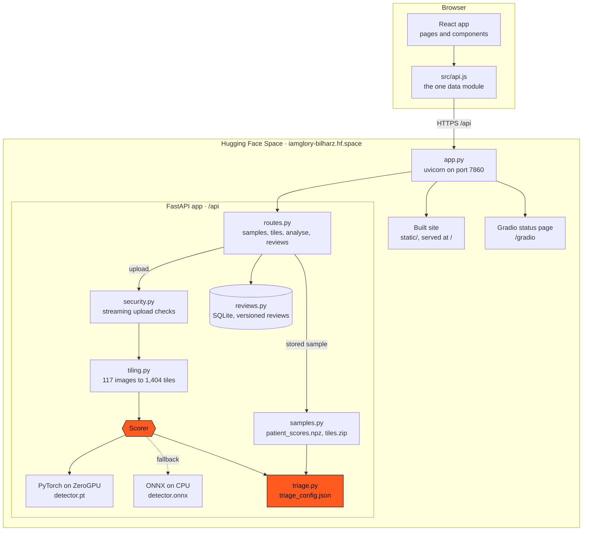

# Architecture

Rendered to [`figures/bilharz-architecture.png`](../figures/bilharz-architecture.png)
with `node frontend/scripts/render-diagram.mjs`.

## How it fits together

One process serves everything. On the Space, [`deploy/space/app.py`](../deploy/space/app.py)
builds the API with `server.create_app`, mounts a small Gradio status page at
`/gradio` (the Gradio SDK needs a Gradio app), serves the built React site from
`static/` with a single-page-app fallback, and runs uvicorn on port 7860. The
same API runs locally with `uvicorn server:app`.

A stored sample's result needs no model: its tile scores were computed once in
notebook 04 and are read from `results/patient_scores.npz`, so the queue and
sample pages only count scores against the triage rule. The model runs only for
an upload.

## Backend modules

| File | Responsibility |
| --- | --- |
| [`api/server.py`](../api/server.py) | `create_app`: wires settings, stores, scorer and routes; CORS, security headers, plain JSON errors |
| [`api/bilharz/settings.py`](../api/bilharz/settings.py) | Every path, origin, limit and secret, read from the environment into a frozen `Settings` |
| [`api/bilharz/routes.py`](../api/bilharz/routes.py) | The endpoints under `/api`, the admin token and review code checks, the CSV export |
| [`api/bilharz/schemas.py`](../api/bilharz/schemas.py) | Pydantic request and response models (snake_case) |
| [`api/bilharz/samples.py`](../api/bilharz/samples.py) | The 65 stored samples (scores, image names, top-12 tiles) and the tile archive |
| [`api/bilharz/triage.py`](../api/bilharz/triage.py) | The rule: count confident tiles, decide negative, referred or positive |
| [`api/bilharz/tiling.py`](../api/bilharz/tiling.py) | One image to 12 tiles, exactly as in the notebooks |
| [`api/bilharz/scoring.py`](../api/bilharz/scoring.py) | The `Scorer` interface and the ONNX scorer |
| [`api/bilharz/analysis.py`](../api/bilharz/analysis.py) | Analysis of one upload, in memory |
| [`api/bilharz/security.py`](../api/bilharz/security.py) | Streaming multipart reader and JPEG checks |
| [`api/bilharz/reviews.py`](../api/bilharz/reviews.py) | SQLite review store with versioning |

## The scorer and its fallback

A scorer is anything with a `name` and a `score(tiles)` method that turns uint8
tiles of shape (N, 256, 256, 3) into egg probabilities (`Scorer` in
[`scoring.py`](../api/bilharz/scoring.py)). There are two:

- `OnnxScorer` runs `detector.onnx` on the CPU in batches of 64. It is the
  default everywhere and the fallback on the Space.
- `TorchGpuScorer` ([`deploy/space/app.py`](../deploy/space/app.py)) runs
  `detector.pt` on ZeroGPU through one `@spaces.GPU` function. It sets
  `whole_sample`, so an upload's 1,404 tiles go in one call and reserve the GPU
  once. Any error there (no GPU free, quota used up, a worker failure) falls back
  to the ONNX scorer for that request.

`create_app` takes the scorer as an argument, so the Space passes the GPU scorer
and tests pass stubs; nothing else changes. Each analysis reports the scorer that
actually ran (`scorer` in the response, through `score_named`), so a fallback is
visible per request.

## Settings and storage

Settings are read once from environment variables into a frozen dataclass and
passed to the parts that need them; nothing else reads the environment. The admin
token and review code are excluded from its `repr`, so they cannot reach a log.

Storage sits behind three small classes that own their files: `SampleStore`
loads only the scores, sample IDs and image names from the `.npz` (the labels in
that file are never loaded, so no response can reveal a diagnosis);
`TileArchive` serves tile JPEGs from `tiles.zip`, with archive members looked up
in the manifest, never taken from the request path; `ReviewStore` opens one
SQLite connection per operation and uses only parameterised queries.

## Frontend

[`frontend/src/api.js`](../frontend/src/api.js) is the only code that talks to the
backend. It converts snake_case responses to camelCase objects, turns errors into
plain messages (a 502, 503 or 504, or no answer at all, becomes "The server is
waking up"), shares identical GET requests already in flight, and keeps the
optional review code in memory only. It also holds the single definition of a
waiting and a reviewed sample.

[`useApi.js`](../frontend/src/useApi.js) calls those functions from components. It
reloads when server data changes (a recorded review bumps a version number every
view subscribes to) and retries once by itself, after 10 seconds, when the server
could not be reached.

Pages ([`frontend/src/pages/`](../frontend/src/pages/)) map one to one to routes:
Landing, Analyse, Result, Review, Queue, Reviews, Performance and not-found.
Shared pieces are in [`frontend/src/components/`](../frontend/src/components/):
the header and navigation, `PageHeader`, `PageState` (loading and error states),
`Toolbar`, `OutcomeMark` and `VerdictMark` (a coloured dot always paired with a
word), `TileCard`, `DecisionScale`, `ReviewCodeGate` and `ExportDialog`.

## Key algorithms

**Tiling** ([`tiling.py`](../api/bilharz/tiling.py)). Each image is resized to
1024 × 768 and cut into a 3 × 4 grid of 256 × 256 tiles, row by row. An egg stays
large enough for the detector, and a sample of 117 images gives 1,404 tiles.

**Confident-tile triage** ([`triage.py`](../api/bilharz/triage.py)). A tile is
confident if its score is above the setting's threshold (0.95 for Safety, the
default; 0.99 for Efficiency). With no confident tile the sample is negative;
with more than `flag_above` (35 or 12) it is positive; anything in between is
referred to a technician.

**Nested threshold selection** (notebook 04). The threshold and both cut-offs are
chosen inside repeated stratified 5-fold cross-validation (20 repeats, split by
patient), from training patients only: the cut-off for positive is the highest
count of any healthy training patient. The deployed rule in
`triage_config.json` is the same procedure fitted once on all 65 patients
(notebook 05).

**Streaming upload validation** ([`security.py`](../api/bilharz/security.py)). The
multipart body is parsed as it arrives. The request size, each file's size and
the number of files are enforced before the whole body has been received; each
file is then checked to be a real JPEG by decoding its header, with a pixel limit
against decompression bombs. The whole upload must arrive within 120 seconds, and
one analysis runs at a time: a second gets 429, and the lock is released however
a request ends. Nothing is written to disk, and uploaded filenames are never kept.

**Versioned reviews with conflict detection** ([`reviews.py`](../api/bilharz/reviews.py)).
A review is never overwritten. A change is a new row that names the review it
replaces (`supersedes`); a sample's current review is its latest row. Inside one
`BEGIN IMMEDIATE` transaction the store checks that `supersedes` is still the
sample's current review before inserting, so of two edits made from the same
version, the second gets 409 instead of silently replacing the first.

## Deployment

[`deploy/build_space.sh`](../deploy/build_space.sh) assembles the Space from this
repository: the backend, the entry point, the assets (with the labels removed
from the scores file), and the built site. The Space runs the Gradio SDK on
ZeroGPU hardware. Gradio is mounted with server-side rendering off, so its Node
server does not take port 7860 first. The site gets a strict Content Security
Policy (scripts, styles and data from its own origin only); the Gradio page gets
a looser one, because it needs inline scripts and styles. Reviews are stored in
SQLite on the Space's disk, which is not persistent: they are lost when the Space
restarts.
